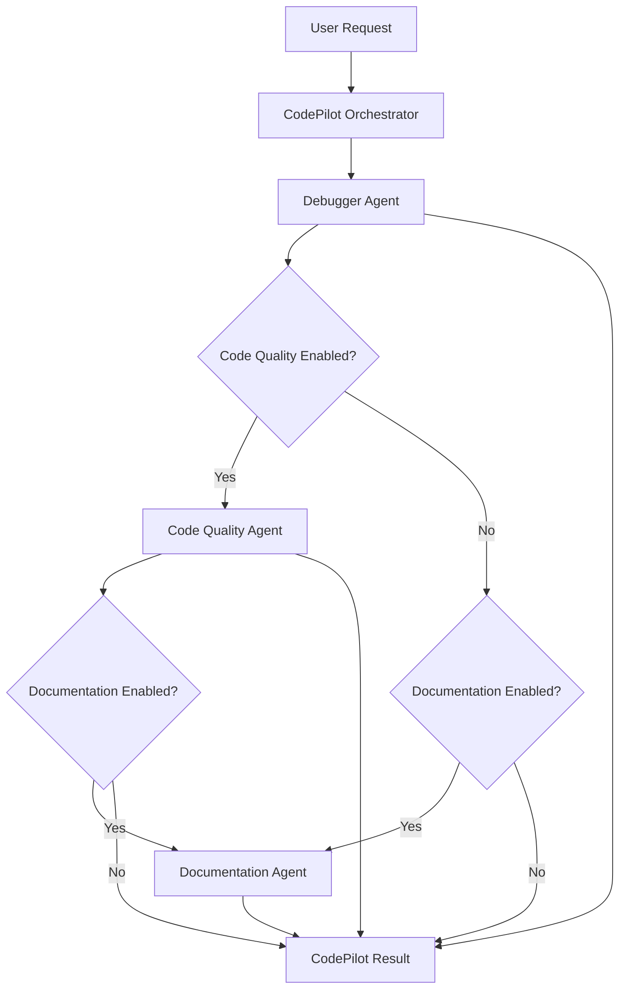

# CodePilot AI — Multi-Agent Code Assistant

An AI-powered code assistant built with **Python, LangChain, and LangGraph** that helps developers analyze bugs, generate and validate code patches, improve code quality, and generate project documentation through specialized agents.

CodePilot AI uses a modular, graph-based architecture in which an orchestrator routes work to dedicated agents according to the selected capabilities.

## Architecture


> Add the workflow diagram to your repository at `docs/codepilot-workflow.png` to display it here.

### High-Level Workflow



The current orchestrator executes the Debugger Agent first, then conditionally invokes the Code Quality Agent and Documentation Agent. The workflow uses conditional routing rather than executing all three agents in parallel.

## Agents and Responsibilities

### 1. Debugger Agent

The Debugger Agent identifies potential bugs, proposes fixes, validates patches, and supports human review before applying approved changes.

**Workflow:**

1. **Extract file manifest** — scans the project and identifies source files.
2. **Find bugs** — analyzes source code and produces structured bug findings.
3. **Generate proposed patches** — generates candidate corrections for detected bugs.
4. **Validate patches** — checks patch applicability and syntax in a validation environment.
5. **Human approval** — pauses execution for review of eligible patches.
6. **Apply approved patches** — revalidates and applies approved changes.
7. **Iterate and report** — performs a subsequent analysis cycle when configured and generates a debugging report.

**Key characteristics**
- Structured bug findings and patch proposals.
- Context-aware code analysis and chunking for large files.
- Retry handling for certain LLM rate-limit errors.
- Human-in-the-loop approval before modifying project files.
- Patch validation before application.
- Debugging status, validation results, and iteration history.

### 2. Code Quality Agent

The Code Quality Agent analyzes code maintainability and provides actionable improvement suggestions without modifying the original source files.

**Workflow:**

1. Extract the project file manifest.
2. Analyze source files for code quality issues.
3. Generate suggestions for identified findings.
4. Return findings, recommendations, and analysis errors.

**Areas of analysis**
- Naming conventions and readability.
- Formatting and documentation.
- Unnecessary complexity.
- Maintainability improvements.
- Actionable recommendations associated with findings.

The agent uses structured output for code quality findings and maintains separate collections for findings, suggestions, and analysis errors.

### 3. Documentation Agent

The Documentation Agent uses an LLM with tool calling to inspect a codebase and generate documentation grounded in the actual source files.

**Available tools**

| Tool | Responsibility |
|---|---|
| `get_project_structure` | Extracts the project file manifest. |
| `read_code_from_file` | Reads source code from a specified file. |
| `list_files` | Lists project files, optionally filtered by extension. |
| `analyze_code` | Explains the structure and behavior of supplied code. |
| `search_code` | Searches source files for symbols or text patterns. |

**Documentation workflow**

1. Receive a request to document the project.
2. Ask the LLM to inspect the project using available tools.
3. Read and analyze relevant files.
4. Identify important components, dependencies, and entry points.
5. Generate README content in Markdown.
6. Return the generated documentation to the orchestrator.

The agent is instructed to avoid inventing project features, dependencies, or setup commands.

## Technology Stack

| Technology | Purpose |
|---|---|
| Python | Core implementation language |
| LangGraph | Workflow orchestration and graph-based agent execution |
| LangChain | LLM integration, prompts, tool calling, and output parsing |
| Pydantic | State models and structured data validation |
| Groq integration | LLM access through the configured model provider |
| Python standard library | File operations, syntax checks, diffs, and supporting utilities |

The exact model and provider configuration depend on the implementation of the project's LLM-selection utilities.

## Project Structure

The following is a representative structure based on the uploaded agent modules. Adjust it to match the complete repository.

```text
CodePilot-AI/
├── agents/
│   ├── code_pilot_agent.py
│   ├── debug_agent.py
│   ├── code_quality_agent.py
│   └── documentation_agent.py
│
├── models/
│   ├── code_pilot_state.py
│   ├── debug_state.py
│   ├── code_quality_state.py
│   └── documentation_state.py
│
├── prompts/
│   ├── debugger_prompt.py
│   ├── code_quality_prompt.py
│   └── documentation_agent.py
│
├── utls/
│   ├── debugger_utils.py
│   ├── generated_testing.py
│   └── pick_llm.py
│
├── data/
│   └── debug/
│
├── docs/
│   └── codepilot-workflow.png
│
├── test_runner.py
├── requirements.txt
└── README.md
```

## Installation and Setup

### Prerequisites

- Python version compatible with the project's installed dependencies.
- A configured LLM provider and valid credentials for the selected model.
- Git, if you want to use the repository's version-control workflow.

### 1. Clone the repository

```bash
git clone <YOUR_REPOSITORY_URL>
cd CodePilot-AI
```

Replace `<YOUR_REPOSITORY_URL>` with your GitHub repository URL.

### 2. Create a virtual environment

**Windows**

```powershell
python -m venv .venv
.venv\Scripts\activate
```

**macOS / Linux**

```bash
python3 -m venv .venv
source .venv/bin/activate
```

### 3. Install dependencies

If the repository contains a `requirements.txt` file:

```bash
pip install -r requirements.txt
```

Otherwise, install the dependencies listed in your project's dependency configuration.

### 4. Configure LLM credentials

Configure the environment variables required by your LLM provider and the `pick_llm` utility. Keep API keys in environment variables or a local environment file, and never commit secrets to GitHub.

### 5. Configure the project path

Set `project_root` to the absolute path of the codebase you want CodePilot AI to analyze.

The parent workflow also requires the agent-selection flags:

- `is_code_quality_agent`
- `is_documentation_agent`

These flags determine which optional agents run after the Debugger Agent.

### 6. Run the workflow

Use the repository's test runner or entry point after configuring the required state and dependencies.

```bash
python test_runner.py
```

The exact invocation depends on how the initial `CodePilotState` is constructed in your runner.

## State Management and Orchestration

The parent workflow uses `CodePilotState` to carry information between agents. The state includes:

- `project_root` — project directory being analyzed.
- `messages` — accumulated agent responses.
- `is_code_quality_agent` — enables or disables code quality analysis.
- `is_documentation_agent` — enables or disables documentation generation.

The debugger uses its own `DebuggingState`, while the Code Quality and Documentation Agents use their respective state models.

LangGraph conditional edges control the execution path. The debugger and its subgraph also use checkpointing to support workflow persistence and human approval interactions.

## Safety and Validation

CodePilot AI separates proposed changes from their application.

- Proposed patches are generated before being applied.
- Patch validation is performed before approval and application.
- Human approval is required for the debugger's eligible patch proposals.
- Approved patches are revalidated before application.
- The Code Quality Agent produces recommendations without changing source files.
- Documentation generation is based on inspected project content.

These safeguards help reduce unintended changes, but generated fixes still require careful review and testing.

## Current Scope and Limitations

- Analysis quality depends on the configured LLM, prompts, and source-code context.
- LLM-generated patches may be incorrect or incomplete.
- Some files or chunks may produce analysis errors.
- Documentation quality depends on the files the agent can inspect.
- The orchestrator currently uses conditional sequential routing; parallel execution is not implemented in the uploaded parent graph.
- Actual installation commands and supported model providers depend on the complete repository configuration.

## Future Improvements

- Add parallel execution for independent analysis agents.
- Add automated unit-test generation and execution.
- Introduce a unified report combining bug findings, code quality issues, and documentation results.
- Add a dashboard for reviewing findings and approving patches.
- Improve patch validation with automated regression tests.
- Add structured logging, execution metrics, and retry policies.
- Support additional LLM providers and configurable agent selection.

## Contributing

Contributions, bug reports, and suggestions are welcome.

1. Fork the repository.
2. Create a feature branch.
3. Implement and test your changes.
4. Open a pull request describing the changes.

## License

Add the license appropriate for your project before distributing or publishing the repository.

---

**CodePilot AI** — Analyze code, validate fixes, improve quality, and generate documentation with specialized AI agents.
